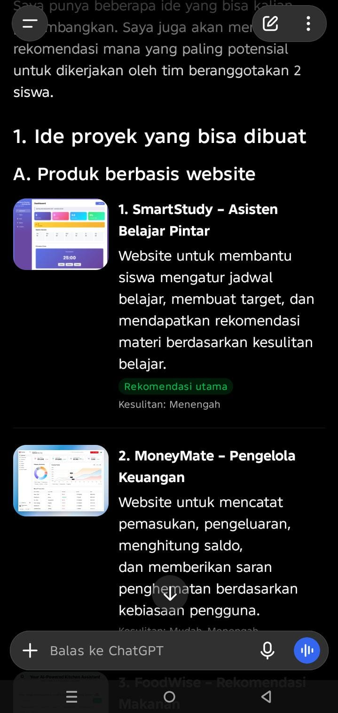

# AI_LOGBOOK.md

## Identitas Proyek

- **Nama proyek:** SmartStudy — Asisten Belajar Pintar
- **Tema:** Solusi Digital untuk Kehidupan Sehari-hari Berbantuan Kecerdasan Artifisial
- **Platform:** Website/PWA
- **Alat AI yang digunakan dalam proses pengembangan:** ChatGPT
- **Anggota:** Muhammad Fajar Devandra dan Natanael Barzilai
- **Sekolah:** SMKN 1 Blitar
- **Jurusan:** Teknik Komputer dan Jaringan (TKJ)
- **Kelas:** XI TJKT 2 (Muhammad Fajar Devandra dan Natanael Barzilai)

> **Keterangan penggunaan AI:** ChatGPT dimanfaatkan sebagai pendamping dalam eksplorasi ide, perancangan fitur, pengembangan struktur website, pembahasan pemrograman, pemecahan kendala teknis, dan penyusunan dokumentasi. Keputusan akhir mengenai fitur dan penerapannya disesuaikan dengan kebutuhan proyek SmartStudy. Logbook ini merangkum proses pengembangan dan penggunaan AI dalam proyek.

---

## Tahap 1 — Eksplorasi Ide dan Perancangan Solusi

**Tujuan:** Menentukan masalah yang dialami pelajar, target pengguna, dan solusi digital yang akan dikembangkan.

### Ringkasan prompt/interaksi AI

> Rancang SmartStudy — Asisten Belajar Pintar untuk pelajar SMA/SMK. Website perlu membantu pengguna mengatur jadwal belajar, mencatat tugas dan tenggat waktu, serta memperoleh rekomendasi belajar berdasarkan mata pelajaran dan tingkat kesulitan.

> Kembangkan gagasan website agar responsif di HP dan komputer serta dapat dipasang seperti aplikasi melalui teknologi PWA.

> Bantu mengembangkan konsep fitur asisten belajar agar pelajar dapat mempelajari materi, membuat ringkasan, dan berlatih soal.

### Dokumentasi eksplorasi ide awal

Pada tahap awal, ChatGPT diminta memberikan beberapa alternatif ide proyek berbasis website dan merekomendasikan ide yang paling potensial untuk dikerjakan oleh tim beranggotakan dua siswa. Salah satu hasil diskusi tersebut ditampilkan pada dokumentasi percakapan yang disimpan sebagai gambar.

Alternatif ide website yang terlihat pada dokumentasi:

1. **SmartStudy — Asisten Belajar Pintar**
   - Website untuk membantu siswa mengatur jadwal belajar, membuat target, dan mendapatkan rekomendasi materi berdasarkan kesulitan belajar.
   - Pada hasil diskusi, SmartStudy ditandai sebagai **rekomendasi utama** dengan tingkat kesulitan **menengah**.

2. **MoneyMate — Pengelola Keuangan**
   - Website untuk mencatat pemasukan dan pengeluaran, menghitung saldo, serta memberikan saran penghematan berdasarkan kebiasaan pengguna.

3. **FoodWise — Rekomendasi Makanan**

Dokumentasi ini menunjukkan bahwa SmartStudy dipilih setelah mempertimbangkan beberapa alternatif, bukan langsung ditentukan tanpa eksplorasi ide.

**Dokumentasi visual eksplorasi ide:**

*Gambar 1. Rekomendasi ide proyek website untuk tim beranggotakan dua siswa.*

### Saran dan hasil diskusi AI

- Membuat dashboard sebagai halaman ringkasan aktivitas belajar.
- Menyediakan fitur jadwal belajar dengan mata pelajaran, hari, waktu, durasi, dan catatan.
- Menyediakan manajemen tugas dengan judul, mata pelajaran, tenggat waktu, prioritas, deskripsi, dan status penyelesaian.
- Menyediakan rekomendasi belajar berdasarkan mata pelajaran dan tingkat kesulitan.
- Mengembangkan tampilan responsif dan fitur instalasi PWA.
- Membahas penggunaan akun dan database online agar data pengguna dapat disimpan dan dimuat kembali.
- Membahas gagasan asisten belajar berbantuan AI. Dalam proses pengembangan, konsep ini disesuaikan dengan fitur belajar yang lebih terarah.

### Keputusan dan penerapan pada proyek

Tim mengembangkan SmartStudy sebagai website/PWA untuk membantu pelajar SMA/SMK mengelola kegiatan belajar. Menu dan fitur yang dibahas/dikembangkan meliputi:

- Dashboard.
- Login dan Register.
- Jadwal Belajar.
- Manajemen Tugas.
- Rekomendasi Belajar.
- Bagian Assistant yang diarahkan menjadi tiga kebutuhan belajar: **Ringkas Materi, Latihan Soal, dan Materi** (termasuk penambahan materi pribadi).
- Pergantian tema gelap dan terang.
- Install Aplikasi/PWA.
- Tim Pengembang.

### Perubahan konsep Assistant

Pada tahap awal, tim membahas penggunaan AI yang dapat memberikan jawaban secara lebih luas. Setelah mempertimbangkan keterbatasan jawaban yang hanya mengandalkan logika atau materi lokal, tim memilih membagi Assistant menjadi tiga menu yang lebih terarah:

1. **Ringkas Materi:** membantu pengguna memperoleh ringkasan dari materi yang dipelajari.
2. **Latihan Soal:** membantu pengguna berlatih dan menguji pemahaman.
3. **Materi:** menyediakan materi pembelajaran dan ruang untuk menambahkan materi pribadi.

Perubahan ini merupakan keputusan desain produk. Implementasi Assistant yang dibahas menggunakan pemrosesan JavaScript dan materi lokal, sehingga fungsinya dijelaskan sebagai alat bantu belajar berbasis fitur lokal.

### Validasi & Modifikasi Mandiri

- Ide AI yang diubah atau tidak digunakan: `Konsep Assistant yang semula mengarah pada satu asisten dengan jawaban luas diubah menjadi Ringkas Materi, Latihan Soal, dan Materi.`
- Alasan keputusan tim: `Tim ingin menyediakan fungsi belajar yang lebih terarah dan mudah dipilih sesuai kebutuhan pelajar.`
- Cara tim memvalidasi kebutuhan/ide: `Tim melakukan diskusi dan meminta teman-teman mencoba website untuk memperoleh masukan mengenai kemudahan penggunaan dan manfaat fitur.`
- Perubahan tambahan yang dilakukan setelah menerima masukan: `Tim mengarahkan fitur Assistant menjadi tiga menu belajar, yaitu Ringkas Materi, Latihan Soal, dan Materi.`

---

## Tahap 2 — Penyusunan Kerangka Kode (Scaffolding)

**Tujuan:** Menyusun struktur website, menentukan teknologi, dan memahami hubungan antarbagiannya.

### Ringkasan prompt/interaksi AI

> Bantu merancang website SmartStudy menggunakan HTML, CSS, dan JavaScript dengan pemisahan struktur halaman, tampilan, dan logika interaktif.

> Jelaskan cara membuat layout responsif untuk HP dan komputer.

> Bantu menambahkan interaksi pada website tanpa menghilangkan fitur yang sudah ada, serta menggabungkan proyek kasir dan elemen portofolio pada proyek website lain yang pernah dibahas.

> Bantu menyiapkan SmartStudy agar dapat menggunakan Supabase untuk autentikasi dan penyimpanan data, serta dapat dipublikasikan melalui GitHub Pages.

> Jelaskan cara membuat website dapat dipasang seperti aplikasi menggunakan PWA.

### Saran dan hasil diskusi AI

- **HTML** digunakan untuk struktur halaman, navigasi, formulir, dan komponen antarmuka.
- **CSS** digunakan untuk tampilan, tata letak, tema terang/gelap, dan responsivitas.
- **JavaScript** digunakan untuk interaksi halaman, validasi input, pengelolaan jadwal dan tugas, rekomendasi, serta fitur Assistant.
- **Supabase Auth** dibahas dan digunakan untuk proses registrasi, login, dan logout.
- **Supabase Database** digunakan untuk menyimpan dan memuat data jadwal serta tugas pengguna.
- **PWA** menggunakan `manifest.json` dan Service Worker agar website mendukung instalasi dan kemampuan aplikasi web.
- **GitHub Pages** dibahas sebagai salah satu pilihan publikasi website statis. Konfigurasi layanan backend tetap perlu disiapkan secara terpisah.

### Penerapan yang dapat ditelusuri pada berkas proyek

| Berkas | Fungsi |
|---|---|
| `index.html` | Struktur halaman, navigasi, formulir, dan komponen antarmuka |
| `style.css` | Gaya visual, tata letak, tema, dan responsivitas |
| `app.js` | Logika interaksi, autentikasi, jadwal, tugas, rekomendasi, Assistant, dan fungsi PWA |
| `supabase-config.js` | Konfigurasi URL dan publishable/anon key untuk koneksi frontend |
| `supabase-config.example.js` | Contoh konfigurasi tanpa nilai proyek sebenarnya |
| `supabase-schema.sql` | Definisi tabel dan kebijakan akses database |
| `manifest.json` | Nama, ikon, dan metadata instalasi PWA |
| `sw.js` | Service Worker untuk mendukung kebutuhan PWA dan cache |
| `supabase/` | Konfigurasi dan berkas backend Supabase yang digunakan pada proses pengembangan |

### Validasi & Modifikasi Mandiri

- Bagian HTML yang dibuat/diubah oleh tim: `Struktur halaman, navigasi, formulir, dan komponen utama SmartStudy disusun pada index.html.`
- Bagian CSS yang dibuat/diubah oleh tim: `style.css digunakan untuk mengatur tata letak, tampilan responsif, dan tema terang/gelap.`
- Fungsi JavaScript yang dibuat/diubah oleh tim: `app.js mengatur interaksi antarmuka, autentikasi, jadwal, tugas, rekomendasi, Assistant, dan fungsi PWA.`
- Alasan penyesuaian dari saran AI: `Tim menyesuaikan saran dengan kebutuhan fitur SmartStudy dan memilih fungsi yang dianggap lebih sesuai untuk pelajar.`
- Cara memeriksa hasil, perangkat, dan browser yang digunakan: `Website dijalankan melalui server lokal Node.js pada komputer Windows dan diperiksa menggunakan browser Chrome.`

---

## Tahap 3 — Pemecahan Masalah dan Penanganan Galat (Debugging)

**Tujuan:** Menggunakan AI sebagai pendamping untuk memahami pesan kesalahan, mencari penyebab, dan menentukan langkah pemeriksaan.

### Ringkasan prompt/interaksi AI

> Bantu menyelesaikan kendala instalasi dan penggunaan Supabase CLI serta menghubungkan project Supabase dengan website SmartStudy.

> Jelaskan perbedaan project URL, project reference, dan publishable/anon key pada konfigurasi Supabase.

> Bantu mengatasi pemuatan `manifest.json` ketika website dibuka langsung menggunakan `file://`, serta jelaskan cara menjalankan website melalui server lokal.

### Masalah yang tercatat dalam diskusi

1. Perintah `supabase link` sempat diarahkan menggunakan URL dashboard, bukan project reference.
2. Proses login Supabase CLI memerlukan kode verifikasi perangkat.
3. Pengaturan konfigurasi Supabase perlu disesuaikan dengan project yang digunakan.
4. Browser memblokir pemuatan manifest ketika halaman dibuka langsung melalui `file://` karena halaman memiliki origin `null`.
5. Python tidak tersedia pada PATH komputer pengguna; Node.js kemudian diketahui tersedia untuk menjalankan server lokal.

### Saran dan langkah penanganan yang dibahas

- Menggunakan project reference yang benar ketika menjalankan `supabase link`.
- Memastikan URL dan publishable/anon key sesuai dengan project Supabase.
- Menjalankan website melalui server lokal, bukan membuka `index.html` langsung dengan `file://`.
- Menggunakan Node.js untuk menjalankan server lokal ketika Python tidak tersedia.
- Memeriksa kembali konfigurasi dan hasil koneksi Supabase saat melakukan pengujian.

### Catatan status dan batas klaim

- Pemeriksaan aplikasi mencakup alur penggunaan website, pemuatan halaman, dan koneksi ke layanan Supabase.

### Validasi & Modifikasi Mandiri

- Kendala yang berhasil direproduksi: `Manifest tidak termuat sebagaimana mestinya ketika halaman dibuka langsung melalui file://.`
- Perubahan kode/konfigurasi yang benar-benar dilakukan: `Website dijalankan melalui server lokal Node.js agar halaman dapat dimuat melalui alamat localhost.`
- Saran AI yang ditolak atau disesuaikan: `Tim memilih saran yang sesuai dengan kebutuhan SmartStudy dan menyesuaikan rancangan fitur agar lebih terarah untuk pelajar.`
- Bukti hasil setelah perbaikan (log, screenshot, atau langkah uji): `Pemeriksaan dilakukan dengan menjalankan website melalui alamat localhost pada browser.`
- Status akhir setiap kendala: `Kendala pemuatan manifest saat menggunakan file:// ditangani dengan menjalankan website melalui server lokal Node.js.`

---

## Tahap 4 — Refleksi dan Penjelasan Kode

**Tujuan:** Memastikan kedua anggota memahami kode, alur data, batasan fitur, dan keputusan teknis SmartStudy.

### Ringkasan prompt/interaksi AI

> Jelaskan bagian-bagian kode SmartStudy, cara kerja Supabase Auth dan penyimpanan jadwal/tugas, serta cara kerja fitur Assistant.

> Bantu menyusun README dan AI_LOGBOOK sesuai kebutuhan dokumentasi proyek, termasuk pengungkapan penggunaan AI dan perubahan mandiri oleh anggota tim.

> Jelaskan langkah penggunaan website dan susun dokumentasi dengan bahasa yang mudah dipahami.

### Pokok pemahaman yang perlu dapat dijelaskan saat presentasi

1. **HTML:** membentuk struktur halaman seperti Dashboard, Jadwal Belajar, Manajemen Tugas, Rekomendasi Belajar, Assistant, Install Aplikasi, dan Tim Pengembang.
2. **CSS:** mengatur tampilan, tata letak responsif, serta tema terang dan gelap.
3. **JavaScript:** mengatur interaksi antarmuka, validasi input, proses jadwal/tugas, rekomendasi, dan fitur Assistant.
4. **Supabase Auth:** `signUp()` digunakan untuk registrasi, `signInWithPassword()` untuk login, dan `signOut()` untuk logout. Proses konfirmasi email bergantung pada pengaturan Supabase.
5. **Database:** pada implementasi yang dibahas, `loadRemote()` digunakan untuk mengambil data dan `syncRemote()` untuk menyimpan perubahan ke tabel `study_data` melalui operasi `upsert()`.
6. **Assistant:** terdiri dari tiga menu, yaitu Ringkas Materi, Latihan Soal, dan Materi. Pemrosesan fitur menggunakan JavaScript dan materi lokal. Fitur ringkasan mengambil beberapa kalimat dari teks yang diberikan, sedangkan materi dan latihan soal disediakan melalui fungsi yang tersedia di aplikasi. Assistant ini merupakan alat bantu belajar berbasis fitur lokal, bukan chatbot AI generatif online.
7. **PWA:** `manifest.json` menyimpan metadata aplikasi, sedangkan `sw.js` menjalankan Service Worker untuk kebutuhan PWA.
8. **Keamanan konfigurasi:** nilai yang boleh digunakan pada frontend harus dibedakan dari secret backend. Jangan mengunggah service role key atau kredensial rahasia backend ke repository publik.

### Pengungkapan penggunaan AI

ChatGPT digunakan sebagai alat bantu selama proses pengembangan, antara lain untuk:

- Mengembangkan ide dan rancangan fitur SmartStudy.
- Memberikan contoh struktur HTML, CSS, dan JavaScript.
- Membantu memahami layout responsif dan interaksi antarmuka.
- Membahas integrasi Supabase Auth dan database.
- Membantu menganalisis pesan error dan langkah debugging.
- Membahas PWA, Service Worker, dan proses menjalankan website secara lokal.
- Membantu menyusun README dan AI_LOGBOOK.

Penggunaan ChatGPT menjadi bagian dari proses pengembangan dan pembelajaran tim. Saran yang diberikan digunakan sebagai bahan pertimbangan, kemudian disesuaikan dengan rancangan SmartStudy. Fitur Assistant dijelaskan sesuai implementasinya sebagai alat bantu belajar berbasis JavaScript dan materi lokal.

### Validasi & Modifikasi Mandiri

- Penjelasan kode yang dapat disampaikan Pengembang 1: `Muhammad Fajar Devandra — menjelaskan perencanaan alur fitur SmartStudy, tujuan setiap fitur, proses pengujian fungsi, serta pertimbangan kemudahan penggunaan dan dokumentasi.`
- Penjelasan kode yang dapat disampaikan Pengembang 2: `Natanael Barzilai — menjelaskan struktur halaman HTML, pengaturan tampilan dan layout melalui CSS, serta interaksi antarmuka yang dibuat menggunakan JavaScript.`
- Bagian kode yang sudah diuji dan dipahami kedua anggota: `Alur penggunaan Dashboard, Jadwal Belajar, Manajemen Tugas, Rekomendasi Belajar, dan navigasi utama SmartStudy.`
- Pembagian pemahaman kode: `Muhammad Fajar Devandra berfokus pada alur fitur, pengujian fungsi, dan dokumentasi. Natanael Barzilai berfokus pada struktur HTML, tampilan CSS, dan interaksi JavaScript.`
- Bukti verifikasi mandiri (demo, catatan uji, atau screenshot): `Demo penggunaan website SmartStudy yang memperlihatkan navigasi dan fitur-fitur utama.`

---

## Refleksi Akhir Tim

**Apa yang dipelajari dari penggunaan AI:**

`Dari proses pengembangan SmartStudy, tim mempelajari bahwa ChatGPT dapat membantu mencari ide, memahami struktur kode, menjelaskan pesan error, dan menyusun dokumentasi. Namun, saran AI perlu diperiksa kembali dan disesuaikan dengan kebutuhan aplikasi. Tim juga perlu memahami kode yang digunakan agar dapat menjelaskan dan mempertanggungjawabkan hasil proyek.`

**Perubahan penting yang dilakukan tim setelah menerima saran AI:**

`Perubahan penting yang dibahas adalah mengarahkan Assistant menjadi tiga menu, yaitu Ringkas Materi, Latihan Soal, dan Materi, agar kebutuhan belajar dapat dipilih dengan lebih jelas.`

**Keterbatasan yang diketahui:**

Assistant pada kode yang pernah diperiksa menggunakan logika JavaScript dan materi lokal, bukan model AI generatif eksternal. Karena itu, kemampuan menjawab atau membuat ringkasan memiliki batas sesuai algoritma dan materi yang tersedia. Fitur yang bergantung pada Supabase memerlukan konfigurasi layanan dan koneksi jaringan.

**Tanggal pembaruan logbook:** `24 November 2026`
